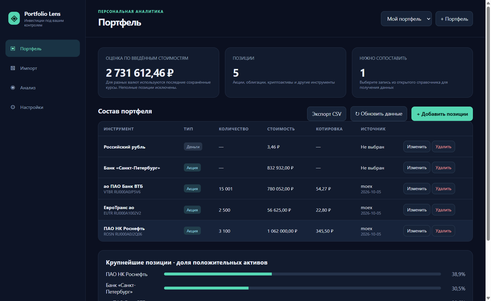
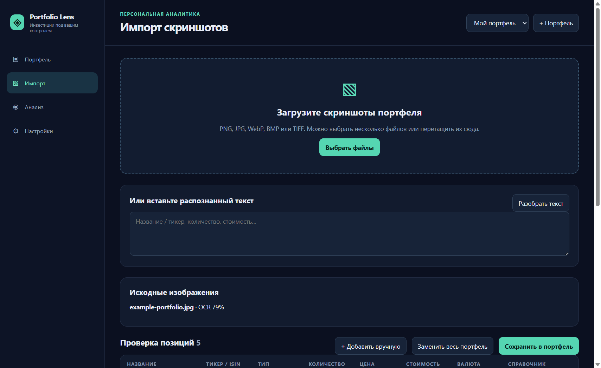
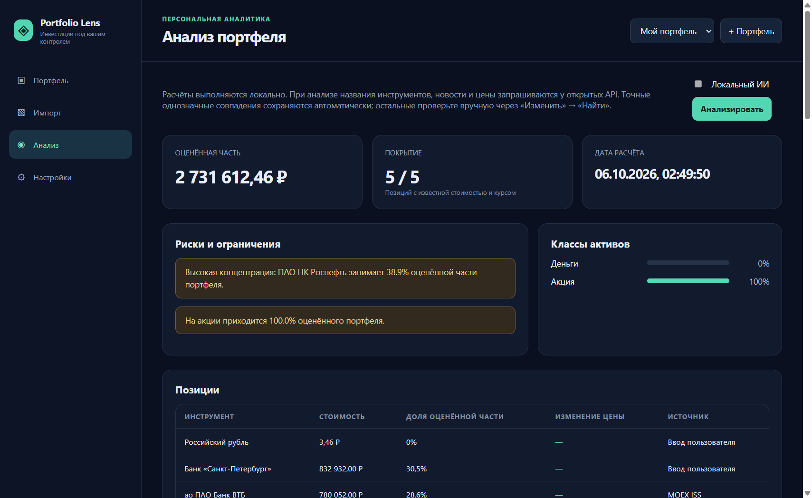
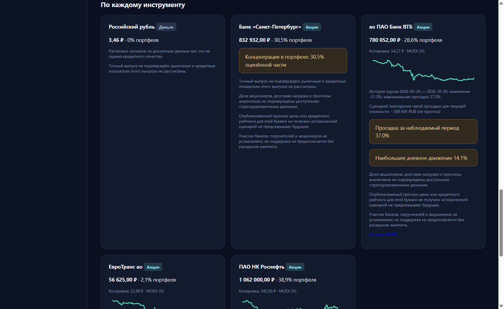

# Portfolio Lens

**Настольное приложение для разбора скриншотов инвестиционного портфеля и проверки его рисков.** OCR и необязательная языковая модель работают на компьютере пользователя. Для поиска инструментов, котировок, курсов и новостей нужен интернет.

[Скачать для Windows](https://github.com/solomka385/portfolio-lens/releases/latest) · [Возможности](#как-это-работает) · [Скриншоты](#интерфейс) · [Сборка](#сборка-из-исходников) · [Ограничения](#ограничения)

### Проекты и источники, которые помогли создать приложение

[public-apis/public-apis](https://github.com/public-apis/public-apis) — каталог открытых API для выбора источников данных · [mattpocock/skills](https://github.com/mattpocock/skills) — инженерные навыки для разработки и тестирования · [Tesseract.js](https://github.com/naptha/tesseract.js) — локальный OCR · [llama.cpp](https://github.com/ggml-org/llama.cpp) — запуск локальной языковой модели · [MOEX ISS](https://www.moex.com/a8531) — справочник и рыночные данные российского рынка.

Навыки из `mattpocock/skills`, включённые в `.agents/skills`, распространяются под MIT; оригинальный текст лицензии сохранён в [.agents/LICENSE](.agents/LICENSE). Перечисленные проекты не являются разработчиками Portfolio Lens и не одобряют его инвестиционные выводы.

## Интерфейс

Скриншоты сделаны **из работающего Portfolio Lens** на предоставленном пользователем примере. Это снимок части портфеля: приложение не приписывает ему скрытые позиции с исходного экрана. Стоимости относятся ко времени изображения, а котировки и публикации — к дате запроса приложения.

| Портфель | Импорт и проверка OCR |
|:--:|:--:|
| [](docs/images/overview.png) | [](docs/images/import.png) |

| Сводка анализа | Риски по инструментам |
|:--:|:--:|
| [](docs/images/analysis.png) | [](docs/images/analysis-details.png) |

## Как это работает

1. Загрузите один или несколько скриншотов портфеля. Приложение распознает текст локальной моделью и покажет таблицу для проверки названий, количества и стоимости.
2. Исправьте ошибки OCR, добавьте недостающие позиции вручную и сохраните их. Перекрывающиеся строки соседних снимков объединяются при совпадении проверяемых признаков.
3. Нажмите **«Анализировать»**. Приложение ищет бумаги в открытых справочниках, запрашивает данные рынка и новости, рассчитывает доли и показывает наблюдавшуюся историю цен.
4. При неоднозначном совпадении выберите инструмент вручную по тикеру или ISIN. Неподтверждённый выпуск не получает чужую котировку или рейтинг.

Поддерживаются акции, облигации, биржевые фонды, криптоактивы и денежные остатки. Портфели хранятся локально в SQLite; доступны экспорт JSON/CSV и импорт резервной копии.

### Источники данных

| Что требуется | Источник | Особенности |
|---|---|---|
| Российские бумаги, фонды, котировки и история | [MOEX ISS](https://www.moex.com/a8531) | Публичные данные могут приходить с задержкой; старые выпуски требуют проверки. |
| Идентификация международных инструментов | [OpenFIGI](https://www.openfigi.com/api) | Справочник не предоставляет котировки; без ключа действуют более низкие лимиты. |
| Криптоактивы | [CoinGecko](https://docs.coingecko.com/) | Ключ Demo необязателен; возможны ограничения запросов. |
| Зарубежные акции | [Alpha Vantage](https://www.alphavantage.co/documentation/) | Требуется личный API‑ключ. |
| Валютные курсы | [Банк России](https://www.cbr.ru/development/sxml/) | Используется последний доступный курс. |
| Публикации | [GDELT](https://www.gdeltproject.org/) и Google News RSS | Заголовки — контекст, а не проверенные факты о компании. |

Названия и идентификаторы отправляются этим сервисам для поиска. Сами скриншоты и база портфелей не загружаются в облако приложения.

## Установка

**Windows 10/11 x64.** Для базовой работы рекомендуется 8 ГБ ОЗУ; для локальной модели Qwen3 4B — 16 ГБ. Выберите актуальный `Portfolio-Lens-Setup-*.exe` на странице [Releases](https://github.com/solomka385/portfolio-lens/releases/latest). MSI доступен там же.

После установки откройте **«Настройки»** и скачайте языковые файлы OCR для русского и английского. Дополнительная OCR-модель может распознавать иначе, поэтому проверяйте каждую строку. Для необязательной текстовой сводки отдельно скачайте движок llama.cpp и Qwen3 4B или 8B. Приложение показывает постоянный каталог моделей в настройках; платные токены для локального OCR и ИИ не требуются.

## Ограничения

- Мелкие таблицы и обрезанные названия могут оказаться нечитаемыми. При низкой достоверности приложение предупредит пользователя и не создаст позиции из случайного текста.
- Рыночные данные, новости и курсы зависят от доступности и задержек внешних сервисов. Введённая стоимость снимка не подменяется новой котировкой без объяснения.
- История цены показывает наблюдавшуюся динамику, а не прогноз. Она не устанавливает кредитный рейтинг, гарантии банка, состав акционеров, структуру фонда или финансовое состояние эмитента.
- Анализ не является индивидуальной инвестиционной рекомендацией. Перед финансовым решением проверяйте карточку конкретного выпуска и документы эмитента.

Технические находки и текущие ограничения подробно изложены в [REVIEW.md](REVIEW.md).

## Сборка из исходников

Нужны Node.js 22+, Windows x64 и [Inno Setup 7](https://jrsoftware.org/isinfo.php) для EXE‑установщика. Команды выполняются из корня проекта:

```powershell
npm ci
npm test
npm start
npm run dist
```

`npm run dist` создаёт EXE и MSI в `release/`. Эта папка, загруженные модели, локальная база и временные файлы исключены из Git. Исходники приложения находятся в `src/`, сборка установщика — в `installer/` и `scripts/`, регрессионные проверки — в `test/`.

**Лицензия исходного кода Portfolio Lens пока не указана.** Лицензии сторонних библиотек и включённых инженерных навыков действуют отдельно.
